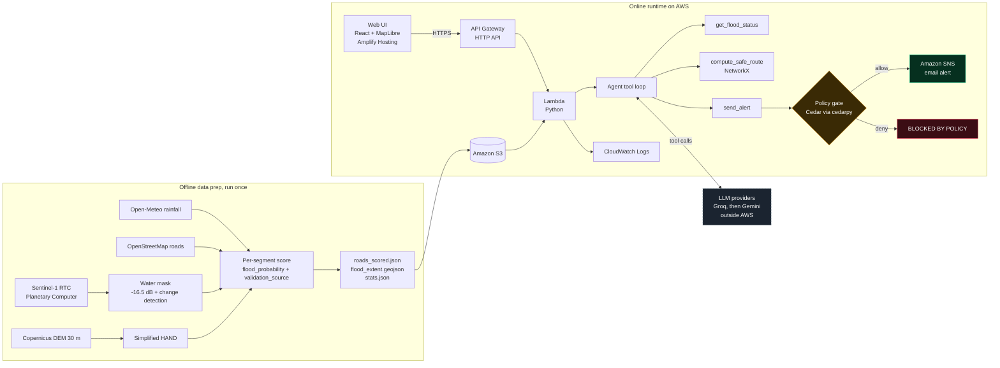
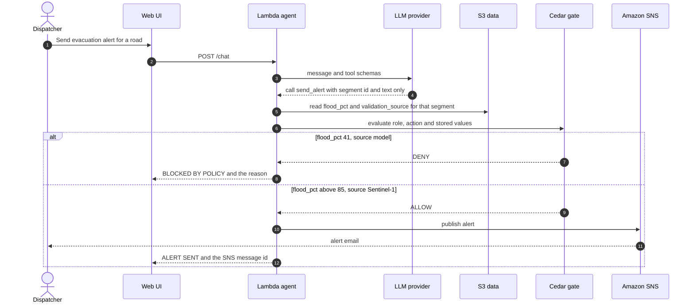

<div align="center">

<h1>🌊 AquaTwin</h1>

<p><b>Radar sees the flood. Code finds the route. A policy decides what the public hears.</b></p>

<p>


</p>

<p>
<a href="https://main.d2qogaiupnpnbe.amplifyapp.com/"><b>▶ Live app</b></a> ·
<a href="https://youtu.be/PBfshHz1JFk?si=iylk8Wl41uEDjaGW"><b>🎬 Demo video</b></a> <!-- TODO: replace with the YouTube link -->
· <a href="#-try-it-in-three-clicks">Try it</a>
· <a href="#-how-it-works">How it works</a>
</p>

<!-- Add after capturing:  -->

</div>

---

> **It is a monsoon night in Delhi.** An underpass is filling and an ambulance is on its way. Which road is safe? And who is allowed to tell the public to evacuate?
>
> AquaTwin answers the first question with **radar-confirmed flood evidence and deterministic routing**, and the second with **a policy gate the AI cannot bypass**.

## ✨ At a glance

| 🛰️ Flood extent | 🌧️ Rainfall | 🛣️ Roads scored | ⚠️ Flooded roads (≥ 50%) | ✅ Radar-confirmed |
|:--:|:--:|:--:|:--:|:--:|
| **1.898 km²**<br>82 polygons | **118.2 mm**<br>8 to 14 Jul 2023 | **15,738**<br>20,012 directed edges | **13 physical**<br>26 directed | **24 directed**<br>by Sentinel-1 |

*Replay of the Delhi Yamuna flood, July 2023 · area `[77.19, 28.62, 77.28, 28.70]`, 78.04 km².*

## 🚨 The problem

- Every monsoon, streets and underpasses in Indian cities flood within hours, and ambulances get sent down roads that are already impassable.
- Optical satellites can't see through monsoon cloud, so control rooms are blind exactly when they need to see.
- An AI that can issue public evacuation alerts on its own is dangerous: one hallucinated broadcast can cause panic, gridlock and real harm.

## 🧭 What AquaTwin does

| | Capability | How it is built |
|---|---|---|
| 🛰️ | **SAR flood extent** | Sentinel-1 C-band radar (RTC), fixed −16.5 dB VV water threshold with change detection, vectorised into flood polygons |
| ⛰️ | **Terrain and rain risk** | Copernicus 30 m DEM → simplified HAND, plus Open-Meteo rainfall, scored per road segment |
| 🗺️ | **Deterministic safe routing** | NetworkX: segments ≥ 0.50 are blocked; the 0.40 to 0.50 "likely to pool" band costs 4× |
| 🤖 | **Dispatcher agent** | Tool-calling agent (Groq first, Gemini fallback) that explains results and drafts alerts. It never invents flood data |
| 🛡️ | **Policy gate** | A Cedar policy, evaluated outside the model, decides whether an alert may fire |
| 📣 | **Real alerts** | Amazon SNS email, sent only when the gate allows it |
| 🖥️ | **Command center** | React + MapLibre + Three.js console: flood map, two-route comparison, reasoning trace, live gate states |

## 🎬 Try it in three clicks

Open the [live app](https://main.d2qogaiupnpnbe.amplifyapp.com/) and scroll to the **Command Center**. Wait about 20 seconds between clicks, because the model runs on free-tier limits.

| Click | What happens | Why it matters |
|---|---|---|
| **Calculate Safe Route** (Ambulance 4 → Lok Nayak Hospital) | Code computes a default and a safe route and draws both on the map; the agent explains the result | Routing is plain code, not model guesswork |
| **Sansad Marg Evacuation Alert** | 🔴 **BLOCKED BY POLICY**: stored data says 41%, model estimate only, no radar confirmation | A hallucinated alert cannot go out |
| **Broadcast Sentinel-1 Advisory** | 🟢 **ALERT SENT** with a real SNS message ID: stored data says 91%, radar-confirmed | Only radar-confirmed evidence authorises a broadcast |

## 🧩 How it works



**The key design rule:** the gate reads `flood_pct` and `validation_source` from the stored dataset, never from the LLM.

### What happens when someone asks for an alert



## 🛰️ How the evidence is built

| Source | Method | Output |
|---|---|---|
| **Sentinel-1 RTC** (Microsoft Planetary Computer) | Pre-event scene `S1A_IW_GRDH_1SDV_20230630T005232…` (30 Jun 2023, 06:22 IST) vs event scene `S1A_IW_GRDH_1SDV_20230712T005233…` (12 Jul 2023, 00:52 UTC / 06:22 IST, about 1 day before the 13 Jul peak). 3×3 median filter, fixed −16.5 dB VV threshold, change detection (Δ < −3 dB). | 1.898 km² flood extent in 82 polygons; 0.595 km of physical roads flooded |
| **Copernicus DEM GLO-30** | 30 m elevation; Euclidean distance from the permanent river channel as a **simplified** HAND: `low_hand_risk = 1 − clip(HAND / 15, 0, 1)` | Terrain risk per road |
| **Open-Meteo** | Daily precipitation, 8 to 14 Jul 2023 | 118.2 mm total; `rain_norm = 118.2 / 200 = 0.591` |
| **OpenStreetMap** | Drivable roads and hospitals from Overpass | 15,738 physical segments (20,012 directed edges); Lok Nayak Hospital |
| **Risk score** | `0.5 × SAR overlap + 0.3 × low HAND + 0.2 × rain_norm` | 13 physical segments ≥ 0.50 (26 directed); 5 physical ≥ 0.85 (10 directed); 24 directed confirmed by Sentinel-1 |

## 🗺️ Routing and the agent

**Routing is plain code.** Edges with `flood_probability ≥ 0.50` are removed from the safe graph. Edges in the 0.40 to 0.50 band that come from the model (not radar) cost 4× their length, which steers vehicles away from low-lying roads that are likely to pool. In the demo corridor (Near Velodrome Road → Lok Nayak Hospital) the direct route is **5.386 km** and the safe route is **6.962 km** (+1.577 km), avoiding 93 at-risk edges.

**The agent has three tools:**

| Tool | What it does |
|---|---|
| `get_flood_status(segment_id)` | Returns stored flood probability, source and flags for a road |
| `compute_safe_route(origin, destination)` | Runs the deterministic router and returns both routes |
| `send_alert(segment_id, message)` | Requests a broadcast, which is checked by the policy gate |

**Model chain:** Groq `openai/gpt-oss-120b` first, Google `gemini-2.5-flash` if Groq is rate-limited or fails. If every provider fails, the API returns `llm_unavailable: true` with a reason instead of faking an answer. Every response reports `model_provider`, `model_name` and `calls_used`.

## 🛡️ Safety model

Controls live in code and data, not in a prompt:

1. **The decision is outside the model.** A Cedar policy ([`cedar/policy.cedar`](cedar/policy.cedar)) decides whether an alert may fire, and the default is deny.
2. **The model supplies almost nothing.** `send_alert` accepts only a `segment_id` and message text ([`agent/tools.py`](agent/tools.py)).
3. **Evidence comes from stored data.** The evaluator reads `flood_pct` and `validation_source` from `roads_scored.json` ([`cedar/evaluator.py`](cedar/evaluator.py)), so the model cannot claim "99% confirmed" and be believed.
4. **The engine is reported.** Every decision includes which engine ran (`cedarpy`, or a native Python evaluator of the same rule if `cedarpy` cannot load).
5. **No LLM in routing.** Routes come from NetworkX ([`routing/engine.py`](routing/engine.py)).
6. **No fake answers.** Provider failure returns `llm_unavailable`, not invented text ([`agent/handler.py`](agent/handler.py)).
7. **No secrets in the package.** Keys live in environment variables, and the Lambda build excludes `.env` and caches ([`deploy/build_lambda.sh`](deploy/build_lambda.sh)).

```cedar
permit(
  principal in Role::"EmergencyManager",
  action == Action::"SendAlert",
  resource
) when {
  context.flood_pct > 85 &&
  context.validation_source == "Sentinel-1"
};
```

> [!NOTE]
> Cedar evaluates policies deterministically and is open source from AWS. It checks the values the application gives it. Here those values come from stored radar-derived data, so the guarantee is "the model cannot change them", not "the data is perfect".

## ☁️ AWS services

| Service | Role |
|---|---|
| **Amazon S3** | Stores the flood extent, scored road graph and statistics |
| **AWS Lambda** | Python backend: `/chat`, `/route`, `/state` |
| **Amazon API Gateway** | HTTP API in front of Lambda, with CORS |
| **Amazon SNS** | Emergency email alerts, only when the gate allows |
| **Amazon CloudWatch** | Lambda logs, token usage and policy decisions |
| **AWS Amplify Hosting** | Hosts the web console |
| **Cedar** (AWS open source) | The policy engine behind the alert gate |

> [!IMPORTANT]
> Amazon Bedrock was blocked on this new free-plan account (`ValidationException: Operation not allowed`), so the agent runs on Groq and Gemini instead. The Strands Agents SDK is **not** used: the agent is a small tool loop on OpenAI-compatible and Google GenAI clients.

## ⚠️ Limitations

> [!WARNING]
> AquaTwin is a **replay** of a past event, not a live flood-warning system. Please read these before relying on any output.

- **Revisit and resolution.** Sentinel-1 passes every 6 to 12 days at about 10 m. It confirms flood *extent*, not water on individual streets.
- **Scene timing.** The event scene was captured at 00:52 UTC on 12 Jul 2023, about a day before the Yamuna peaked on 13 Jul, so it under-represents the peak.
- **Urban clutter.** Buildings cause double-bounce backscatter that can hide standing water in dense streets.
- **Simplified HAND.** Terrain risk uses straight-line distance from the river, not true flow routing.
- **"Likely to pool" is an estimate.** The 0.40 to 0.50 band is a model estimate from terrain and rain, not confirmed water.
- **Free-tier models.** Groq and Gemini limits are tight, and long sessions can fall back or return `llm_unavailable`.

## 🚀 Run locally

```bash
git clone https://github.com/omjee45/AquaTwin.git
cd AquaTwin
pip install -r requirements.txt
cp .env.example .env        # then add your keys (never commit .env)
python deploy/lambda_handler.py       # backend on http://localhost:8000
```

```bash
cd frontend
npm install
npm run dev                            # UI on http://localhost:3000
```

Optional: rebuild the data with `pip install -r prep/requirements.txt && python prep/build_data.py` (results are already in `prep/out/`).

**Environment variables (names only):** `MODEL_PROVIDERS`, `OPENAI_COMPAT_BASE_URL`, `OPENAI_COMPAT_API_KEY`, `OPENAI_COMPAT_MODEL`, `GEMINI_API_KEY`, `GEMINI_MODEL`, `SNS_TOPIC_ARN`, `DATA_BUCKET`, `DATA_PREFIX`.

## 📦 Deploy (summary)

1. `python deploy/setup_aws.py you@example.com` creates the S3 bucket and SNS topic. Confirm the SNS email subscription.
2. `bash deploy/build_lambda.sh` builds `lambda_package.zip` for Linux, excluding secrets.
3. Create the Lambda function and an API Gateway HTTP API (routes `/state`, `/chat`, `/route`, CORS on). Set the environment variables in the Lambda console.
4. Build the frontend with `VITE_API_URL` set to the API URL, then deploy `dist/` to Amplify Hosting.

## 🗂️ Repository

```text
AquaTwin/
├── agent/        handler.py (provider chain, tool loop) · tools.py (3 tools)
├── cedar/        policy.cedar · evaluator.py (cedarpy, with reported fallback)
├── routing/      engine.py (NetworkX: block ≥ 0.50, ×4 penalty in the 0.40-0.50 band)
├── prep/         build_data.py (SAR, DEM, rain, OSM, scoring) · out/ (datasets)
├── deploy/       build_lambda.sh · lambda_handler.py · setup_aws.py
├── frontend/     React + MapLibre + Three.js command center
├── docs/         diagrams and screenshots
├── spec.md       project specification
└── LICENSE       MIT
```

## 🧱 Known gaps

| Gap | Why | What would fix it |
|---|---|---|
| Replay, not live | Needs a live Sentinel-1 ingestion pipeline | Scheduled ingestion on Lambda or Step Functions |
| Radar can't see streets | 10 m resolution and urban clutter | Add rainfall nowcasts, drainage data, higher-resolution SAR |
| Free-tier model limits | No Bedrock access on this account | Enable Bedrock; the provider chain is already pluggable |
| Public demo API | Built for judges to try quickly | Add Cognito or API keys, plus a WAF |

## 🤖 AI tools used

- **Gemini** and **Claude**: planning and architecture
- **Runtime models:** Groq `gpt-oss-120b`, with Google Gemini `gemini-2.5-flash` as fallback

All code was reviewed and tested by the team.

## 🙏 Data sources and attributions

- **OpenStreetMap**: © [OpenStreetMap contributors](https://www.openstreetmap.org/copyright), ODbL
- **Copernicus Sentinel-1**: contains modified Copernicus Sentinel data (2023), accessed through the Microsoft Planetary Computer STAC API
- **Copernicus DEM GLO-30**: © ESA / European Union, Copernicus programme
- **Open-Meteo**: weather data by [Open-Meteo.com](https://open-meteo.com/), [CC BY 4.0](https://creativecommons.org/licenses/by/4.0/)
- **Basemap**: Esri World Dark Gray Canvas, © Esri, HERE, Garmin, OpenStreetMap contributors
- **Frontend**: React, MapLibre GL, Three.js, GSAP, Lucide, Tailwind CSS, Vite
- **Backend**: NetworkX, cedarpy, boto3, requests, python-dotenv, google-genai, openai
- **Fonts**: Plus Jakarta Sans, Space Grotesk, Inter, JetBrains Mono (Google Fonts)

## 📄 License

[MIT](LICENSE)
